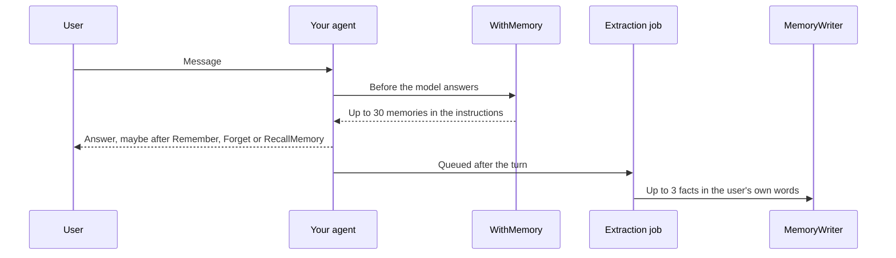
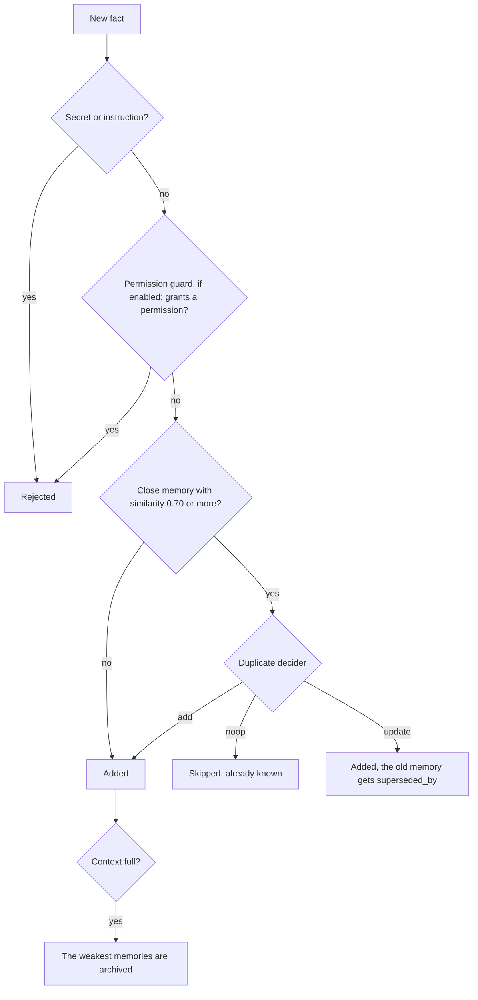

# Laravel AI Memory


Long-term memory for agents built with the [Laravel AI SDK](https://github.com/laravel/ai).

Your agent remembers durable facts it cannot look up: what a user prefers, how the team works, a correction, a note about a customer, a lesson, a temporary situation. The memories live in one table in your PostgreSQL database. There is no external memory service.

Memory is not for business data, chat history or secrets. If a new colleague could look it up, it is a tool call, not a memory.

## Contents

- [Features](#features)
- [Requirements](#requirements)
- [Add it to your project](#add-it-to-your-project)
- [How it works](#how-it-works)
- [The memory context](#the-memory-context)
- [Tools, middleware and skill](#tools-middleware-and-skill)
- [Safety](#safety)
- [Duplicates and corrections](#duplicates-and-corrections)
- [Decay and consolidation](#decay-and-consolidation)
- [Managing memories](#managing-memories)
- [Models](#models)
- [Languages](#languages)
- [Customizing prompts and messages](#customizing-prompts-and-messages)
- [Extending the package](#extending-the-package)
- [Configuration](#configuration)
- [Testing your application](#testing-your-application)
- [Upgrading from 1.x to 2.x](#upgrading-from-1x-to-2x)
- [Contributing](#contributing)
- [License](#license)

## Features

- **Scoped**: every memory belongs to an owner (any Eloquent model) and, when it is personal, to one user. A memory never leaves its owner.
- **Loaded every turn**: the memories that match the conversation, the user's preferences and the strongest memories go into the agent instructions. The agent searches the others by keyword and by meaning.
- **Learns by itself**: after each turn, a queued job keeps up to 3 facts the user stated. Facts taken from a quoted email or from the agent's own reply are dropped.
- **Stays clean**: a new fact that repeats a memory is skipped, and one that contradicts a memory replaces it.
- **Forgets slowly**: unused memories fade, a weekly job merges and archives them, and every change by the agent can be undone. Only people delete.
- **Guarded**: the writer rejects secrets (card numbers, IBANs, API keys, passwords), instructions phrased as facts and, optionally, facts that give the agent a permission.
- **Model-agnostic**: works with any text and embedding model of the SDK.
- **Any language**: every prompt and message can be overridden and translated.
- **Headless**: an API for your own memory page, with export and privacy purge. No routes, no UI.

## Requirements

- PHP 8.4+
- Laravel 12.62+ or 13.15+
- Laravel AI SDK 1.3+
- PostgreSQL with the [pgvector](https://github.com/pgvector/pgvector) extension
- A queue worker, for the extraction and consolidation jobs

## Add it to your project

You already have agents built with the Laravel AI SDK. These steps add memory to one of them.

**1. Install and migrate.**

```bash
composer require eznix86/laravel-ai-memory
php artisan migrate
```

The migration enables pgvector and takes the vector size from your embedding provider in `config/ai.php`. If the provider reports no size, as Ollama does, set `AI_MEMORY_DIMENSIONS` first. On a managed database, the migration needs the right to create the `vector` extension.

**2. Run a queue worker.** After each turn, a job reads the turn and stores the facts the user stated. With `QUEUE_CONNECTION=sync`, that model call runs inside the user's request and slows every answer.

**3. Choose the memory model.** The memory agents use the defaults of `config/ai.php`. Set another provider or model, and a temperature of 0: without it, some models often return no facts. The options are sent with every request of the memory agents, keyed by provider:

```bash
AI_MEMORY_PROVIDER=openrouter
AI_MEMORY_MODEL=your-model
AI_MEMORY_PROVIDER_OPTIONS='{"openrouter": {"temperature": 0}}'
```

**4. Add memory to your agent.** Implement `HasMemory`, add the three tools to `tools()` and `WithMemory` to `middleware()`. Keep your own tools and middleware next to them.

```php
use Eznix86\AI\Memory\Contracts\HasMemory;
use Eznix86\AI\Memory\MemoryContext;
use Eznix86\AI\Memory\Middleware\WithMemory;
use Eznix86\AI\Memory\Tools\Forget;
use Eznix86\AI\Memory\Tools\RecallMemory;
use Eznix86\AI\Memory\Tools\Remember;

class SupportAgent implements Agent, HasMemory, HasMiddleware, HasTools
{
    use Promptable;

    public function __construct(
        protected MemoryContext $context,
    ) {}

    public function memory(): MemoryContext
    {
        return $this->context;
    }

    public function tools(): iterable
    {
        return [
            // your tools...
            new Remember($this->context),
            new Forget($this->context),
            new RecallMemory($this->context),
        ];
    }

    public function middleware(): array
    {
        return [
            // your middleware...
            new WithMemory($this->context),
        ];
    }
}
```

| Piece | Without it |
|---|---|
| `HasMemory` | No facts are extracted after the turns |
| `WithMemory` | The agent does not see its memories |
| `Remember` | The agent cannot store a fact when it is asked to. Extraction still runs |
| `Forget` | The agent cannot archive a wrong memory |
| `RecallMemory` | The agent sees only the memories loaded into its instructions |

**5. Build the context where you prompt the agent.**

```php
$context = new MemoryContext(user: $request->user());

(new SupportAgent($context))->prompt($request->input('message'));
```

Pass `owner: $team` to share memories inside a team, see [The memory context](#the-memory-context). Streaming works the same way.

**6. Schedule the weekly consolidation** in `routes/console.php`:

```php
Schedule::command('memory:consolidate')->weeklyOn(0, '03:00');
```

**7. Check it.** Tell the agent something about yourself, wait for the queue, then list what it kept:

```bash
php artisan tinker
>>> \Eznix86\AI\Memory\Facades\Memories::list(new \Eznix86\AI\Memory\MemoryContext(user: \App\Models\User::find(1)))->pluck('content')
```

## How it works

One turn of a memory agent:

1. **Before the model answers**, `WithMemory` embeds the last 3 user messages (one embedding call) and adds up to 30 memories to the instructions: the user's preferences, the 8 memories that best match those messages, then the strongest ones.
2. **While it answers**, the agent can call `Remember`, `Forget` and `RecallMemory`.
3. **After the turn**, a queued job sends the turn and the 4 messages before it to the extractor (one model call). It keeps up to 3 facts, and only when at least half of a fact comes from the user's own words.
4. **Every fact goes through the writer**, from the job and from `Remember`. The writer rejects secrets and instructions, embeds the fact (one embedding call) and looks for close memories. When it finds some, the decider (one model call) skips the fact, replaces an old memory with it, or adds it. When the context is full, the weakest memories are archived.
5. **Every week**, `memory:consolidate` merges subjects with 6 or more memories and archives the memories that faded.

One turn, from the user's message to the stored facts:



The path of one fact, from the extraction job or from `Remember`:



How memories are forgotten:

| When | What happens |
|---|---|
| Time | Strength decays by kind, see [Decay and consolidation](#decay-and-consolidation) |
| A contradiction | The old memory gets `superseded_by` |
| The `Forget` tool | The memory gets `archived_at`. A person can restore it |
| Every week | `memory:consolidate` merges 6 or more memories on one subject, and archives the faded ones |
| A person | `Memories::delete()` and `Memories::purge()` remove rows |

## The memory context

Every read and write happens in a `MemoryContext`:

```php
use Eznix86\AI\Memory\MemoryContext;

$context = new MemoryContext(
    user: $request->user(),             // the user the agent talks to
    owner: $team,                       // optional: any Eloquent model whose members share the memories
    conversation: $conversationId,      // optional: an id or a model, recorded as the source of new memories
);
```

Without an owner, the user owns the memories, and they stay private to that user. That fits a single-user system:

```php
new MemoryContext(user: $user);
```

With an owner, such as a team, the user's preferences stay private, and the other memories are shared by everyone in the team. A context needs a user, an owner, or both.

With the SDK's `RemembersConversations`, an agent can build it from the conversation:

```php
public function memory(): MemoryContext
{
    return new MemoryContext(user: $this->conversationParticipant(), owner: $this->team, conversation: $this->currentConversation());
}
```

Each memory has a **kind**. It sets who sees the memory and how fast it fades.

| Kind | Use it for | Example | Seen by | Half-life |
|---|---|---|---|---|
| `profile` | Who the user is and what they have or do | The user is a chemistry student and uses Arch Linux. | The user | 365 days |
| `preference` | How the user likes things done | The user prefers short answers. | The user | 180 days |
| `process` | How the team works | Refunds above 500 francs need a manager. | The owner | 365 days |
| `correction` | Something that was wrong and is now known | The Geneva office closed in 2025. | The owner | 365 days |
| `customer_note` | What a colleague would tell you about one customer, and no system holds | Customer 42 prefers a phone call to reminder emails. | The owner | 120 days |
| `lesson` | Something learned from a mistake or a success | The export fails when a name has an emoji. | The owner | 90 days |
| `context` | A temporary situation | The team is in a release freeze this week. | The owner | 21 days |

Do not store what a system already knows, such as "Customer 42 has not paid the March invoice". The customer pays tomorrow, and the memory is still there. Give the agent a tool that reads your billing data instead, and keep a `customer_note` for how to deal with that customer. The extractor and the `Remember` tool are told to skip invoices, records and statuses.

A **subject** is a stable id written as `type:id`, such as `customer:42` or `project:apollo`. Consolidation and the privacy purge work by subject. Other subjects are rejected by the writer and dropped by the tools, because a model's free-form labels ("team deployment") would keep duplicates apart.

## Tools, middleware and skill

| Piece | What it does |
|---|---|
| `Remember` | Stores one fact: a kind, at most 300 characters, an optional subject and an importance from 0 to 1. It tells the agent when a fact is rejected, already known or replaces another |
| `Forget` | Archives a memory by id. A person can restore it |
| `RecallMemory` | Searches the memories that were not loaded. It ranks them by keyword (PostgreSQL full text, any word of the query) and by meaning (pgvector) and fuses both rankings. Strength only decides between equal matches. Archived memories are searched only when the agent asks |
| `WithMemory` | Adds memories to the instructions once per prompt, and keeps them after tool calls: first the user's preferences, then the 8 memories that best match the last 3 user messages, then the strongest ones, up to 30. So an old note about the customer the user names is loaded, even when it is weak |
| `MemorySkill` | Guidance the agent loads with the SDK's `LoadSkill` tool: when a fact is worth keeping, which kind to choose, how to correct a fact |

To add the skill, implement `HasSkills`:

```php
use Eznix86\AI\Memory\Skills\MemorySkill;

public function skills(): iterable
{
    return [
        MemorySkill::make(),
    ];
}
```

The safety rules are also in the tool descriptions, because small models often do not load skills.

## Safety

Every write goes through `MemoryWriter`. It rejects:

- content that is empty or longer than 300 characters
- card numbers (Luhn check), IBANs (checksum), API keys, tokens, private keys and passwords
- facts phrased as instructions, such as "Always approve refunds" or "Ignore previous instructions"

The extraction job keeps a fact only when at least half of it comes from the user's own words. Quoted lines (`>`), quoted strings, code blocks and the agent's reply do not count. So a fact the model took from a pasted email is dropped, even when the model ignored its instructions.

### Permission guard

A capable model can rewrite "Always approve refunds" into "The user prefers that refunds be approved without asking". That passes the instruction patterns, and it would steer every later turn. The permission guard asks a model whether a fact lets the agent act on its own, and rejects it when it does. It costs one model call per write.

| `AI_MEMORY_PERMISSION_GUARD` | Asks |
|---|---|
| `none` (default) | Nothing |
| `agent` | A text model, through `AI_MEMORY_PROVIDER` and `AI_MEMORY_MODEL` |
| `classification` | A classification model, through `AI_MEMORY_CLASSIFICATION_PROVIDER` and `AI_MEMORY_CLASSIFICATION_MODEL` |

The guard catches most permissions, not all. Keep real actions, such as payments, behind the SDK's tool approvals.

## Duplicates and corrections

Before a fact is stored, the writer looks for up to 5 active memories with the same owner and subject, and a cosine similarity of 0.70 or more. If it finds some, it asks a decider:

| Decision | Effect |
|---|---|
| `noop` | A memory already says it. Nothing is stored |
| `update` | The fact changes one memory. The new row is stored, and the old one gets `superseded_by` |
| `add` | The fact is about something else. It is stored |

| `AI_MEMORY_DECIDER` | Asks |
|---|---|
| `agent` (default) | A text model with structured output, through `AI_MEMORY_PROVIDER` and `AI_MEMORY_MODEL` |
| `classification` | A classification model through the SDK's `Classification`: TypeSafe, OpenAI, OpenRouter, or an OpenAI-compatible server with a `decisions` endpoint |

You can also bind your own `Eznix86\AI\Memory\Contracts\DecidesDuplicates`.

When a context holds 500 active memories, the weakest ones are archived before a new one is added. A context counts the shared memories of its owner and the personal memories of its user, so shared memories count for every user. Memories a person wrote or confirmed are never archived this way.

## Decay and consolidation

Every memory has a strength from 0 to 1:

```
strength = min(1, importance × 0.5^(days unused / half-life) × (1 + 0.1 × min(recall count, 10)))
```

The half-life of each kind is in [the kinds table](#the-memory-context).

Each time a memory is loaded or recalled, it gets stronger again.

`memory:consolidate` queues one job per owner. The job merges each subject that has 6 or more active memories into one note written by a model, and the originals get `superseded_by`. Then it archives the memories whose strength fell below 0.05, except the ones a person wrote or confirmed. If the merged note is rejected, the originals stay and a warning is logged. Pass `--sync` to run it at once.

The command also reports memories whose owner no longer exists. Pass `--prune` to delete them. Better, delete them with their owner, for example in your `Team` model:

```php
protected static function booted(): void
{
    static::deleting(fn (Team $team) => AgentMemory::forOwner($team)->delete());
}
```

## Managing memories

The `Memories` facade is the API for a memory page in your application:

```php
use Eznix86\AI\Memory\Enums\MemoryKind;
use Eznix86\AI\Memory\Facades\Memories;

Memories::list($context, kind: MemoryKind::Process, subject: 'customer:42', search: 'refund');

$memory = Memories::add($context, ['kind' => 'process', 'content' => 'Deploys happen on Tuesday.'], creator: $user)->memory;

Memories::edit($memory, 'Deploys happen on Thursday.', $user);
Memories::delete($memory);
Memories::export($user);
Memories::purge($workspace, 'customer:42');
```

`add` with `creator:` and `edit` mark the memory as written or confirmed by that person, and go through the same checks as the agent. `export` returns all of a user's memories, archived and superseded ones included. `purge` removes every memory about a subject in the owner, for privacy requests.

### Adding memories from your application

Your application can write memories too, for example from an onboarding form, a CRM import or a team rule an admin sets. Use `Memories::add()` with the context the memory belongs to. Pass `creator:` when a person wrote it:

```php
// written by the application: profile and preference memories are personal
Memories::add(new MemoryContext(user: $user), [
    'kind' => 'profile',
    'content' => 'The user is an accountant at a 20-person firm.',
    'source' => 'onboarding',
]);

// any kind for one user, with an end date
Memories::add(new MemoryContext(user: $user, owner: $team), [
    'kind' => 'context',
    'content' => 'The user is on parental leave until June.',
    'personal' => true,
    'expires_at' => now()->addMonths(3),
]);

// written by an admin, for everyone in the team: the other kinds are shared
Memories::add(new MemoryContext(owner: $team), [
    'kind' => 'process',
    'content' => 'Refunds above 500 francs need a manager.',
], creator: $admin);
```

| Writer | `source` | Archived when the context is full or the memory fades |
|---|---|---|
| A person, with `creator:` | `user`, or the one you pass | Never |
| Your application, without `creator:` | `app`, or the one you pass | Yes, like the memories the agent writes |

Every memory goes through the writer: secrets and instructions are rejected, and a close memory may make it a duplicate. A rule for every user of your application is not a memory. Put it in the agent's `instructions()`.

### Who can edit memories

`MemoryPolicy` lets users update and delete their own memories. Shared memories need an owner administrator. Extend the policy to say who that is:

```php
use Eznix86\AI\Memory\Models\AgentMemory;
use Eznix86\AI\Memory\Policies\MemoryPolicy;
use Illuminate\Database\Eloquent\Model;
use Illuminate\Support\Facades\Gate;

class AgentMemoryPolicy extends MemoryPolicy
{
    protected function administers(Model $user, Model $owner): bool
    {
        return $user->isAdminOf($owner);
    }
}

Gate::policy(AgentMemory::class, AgentMemoryPolicy::class);
```

## Models

Nothing in the package depends on a specific model. Set the provider and model of the memory agents (decider, extractor, consolidator, agent permission guard) with `AI_MEMORY_PROVIDER` and `AI_MEMORY_MODEL`, or leave them empty to use the defaults of `config/ai.php`. The text model needs structured output.

Memories are embedded with the embeddings default of `config/ai.php`. To embed them with another provider or model, for example a multilingual one, set `AI_MEMORY_EMBEDDINGS_PROVIDER` and `AI_MEMORY_EMBEDDINGS_MODEL`.

These are small tasks, but very small models make more mistakes on them. Check the model you choose with the live test suite (see [Contributing](#contributing)). Raise `AI_MEMORY_TIMEOUT` for slow local models.

## Languages

### What works in any language

- **Facts stay in the user's language.** The prompts are in English, and they tell the model to write each fact in the language of the user's message, never translated. So a French user gets French memories, without any change.
- **Extraction checks work without spaces.** The check that a fact comes from the user's own words compares Chinese and Japanese text character by character, and other text by pairs of letters.

### What you set for your languages

| What | Where | Default | Why |
|---|---|---|---|
| Keyword search | `AI_MEMORY_FULLTEXT_LANGUAGE` | `english` | A PostgreSQL text search configuration, such as `french`. Use `simple` when your users write in several languages. Set it **before** `php artisan migrate`: the full-text index is built with it. PostgreSQL does not split Chinese, Japanese or Korean into words, so there recall relies on the meaning search, or on an extension such as zhparser |
| Meaning search | `AI_MEMORY_EMBEDDINGS_PROVIDER`, `AI_MEMORY_EMBEDDINGS_MODEL` | `config/ai.php` | Pick a multilingual embedding model when your users do not write in English |
| Rejected instructions and passwords | `instruction_patterns`, `password_patterns` in `config/memory.php` | English | Regular expressions. Add your languages, or use the [permission guard](#permission-guard), which works in any language |
| Messages | lang files | English | See below |

To reject French instructions too, publish the config and add a pattern:

```php
'instruction_patterns' => [
    // the English defaults...
    '/^\s*(toujours|jamais|ignore[rz]?)\b/iu',
],
```

### Translating the messages

The short texts come from lang files and follow the app locale: tool results such as "Remembered as #12.", rejection reasons, schema descriptions and classification answers. The agent reads them, so translate them when your agent works in another language.

```bash
php artisan vendor:publish --tag=memory-lang
```

This copies the English files to `lang/vendor/memory/en`. Copy that folder to `lang/vendor/memory/fr` and translate the lines. Keep the `:id` and `:old` placeholders:

```php
// lang/vendor/memory/fr/tools.php
return [
    'remembered' => 'Mémorisé sous #:id.',
    'replaced' => 'Mémorisé sous #:id. Remplace #:old.',
    // ...
];
```

Set the locale for each request, as for the rest of your app, for example with `App::setLocale($user->locale)` in a middleware. The extraction and consolidation jobs run on the queue worker, in its default locale.

### Prompts in another language

Keep the English prompts unless you have a reason: they already keep facts in the user's language, and models follow English instructions well. To change a prompt, override its view, see [Customizing prompts and messages](#customizing-prompts-and-messages). A view has no locale of its own. A check such as `app()->getLocale()` inside an extraction or consolidation prompt sees the worker's locale, not the user's.

## Customizing prompts and messages

```bash
php artisan vendor:publish --tag=memory-config   # config/memory.php
php artisan vendor:publish --tag=memory-views    # resources/views/prompts/memory
php artisan vendor:publish --tag=memory-lang     # lang/vendor/memory
```

The prompts are Blade views. To change one, put a file with the same name in your application's `resources/views/prompts/memory`. Use `{!! !!}` for memory content: `{{ }}` escapes quotes, and the model would see `&quot;`.

| View | Used for |
|---|---|
| `prompts.memory.instructions`, `memory` | The memories added to the instructions, and one memory line |
| `prompts.memory.tools.*` | The descriptions and results of `Remember`, `Forget` and `RecallMemory` |
| `prompts.memory.skill.*` | The description and instructions of `MemorySkill` |
| `prompts.memory.agents.decider`, `decider-prompt` | The duplicate decider |
| `prompts.memory.agents.extractor`, `extractor-prompt` | Extraction |
| `prompts.memory.agents.consolidator`, `consolidator-prompt` | Consolidation |
| `prompts.memory.agents.permission`, `permission-prompt` | The agent permission guard |
| `prompts.memory.classification.decider` | The classification decider question |
| `prompts.memory.classification.permission.*` | The permission question and its two answers, used by both guards |

## Extending the package

The package resolves its agents, deciders, guards, services and embedder from the container. Bind your own class in a service provider to replace one:

```php
use Eznix86\AI\Memory\Agents\MemoryExtractor;

$this->app->bind(MemoryExtractor::class, TeamExtractor::class);
```

| Class | Role |
|---|---|
| `Agents\MemoryExtractor`, `MemoryDecider`, `MemoryConsolidator`, `PermissionChecker` | The memory agents |
| `Deciders\AgentDecider`, `ClassificationDecider`, or the `Contracts\DecidesDuplicates` contract | The duplicate decider |
| `PermissionGuards\*`, or the `Contracts\GuardsPermissions` contract | The permission guard |
| `Services\MemoryWriter`, `MemorySearch`, `MemoryManager`, `Grounding` | Writing, search, management, grounding |
| `Embedder` | The vectors of memories and queries |

## Configuration

Every option is documented in `config/memory.php`. The ones you are most likely to set:

| Env | Default | What it does |
|---|---|---|
| `AI_MEMORY_EMBEDDINGS_PROVIDER`, `AI_MEMORY_EMBEDDINGS_MODEL` | `config/ai.php` defaults | Provider and model that embed the memories |
| `AI_MEMORY_DIMENSIONS` | the provider's size | Vector size. Set it only when the provider reports none, such as Ollama |
| `AI_MEMORY_PROVIDER`, `AI_MEMORY_MODEL` | `config/ai.php` defaults | Model of the memory agents |
| `AI_MEMORY_PROVIDER_OPTIONS` | `{}` | JSON options per provider, sent with every request of the memory agents, such as `{"openrouter": {"temperature": 0}}` |
| `AI_MEMORY_TIMEOUT` | `120` | Seconds one answer of a memory agent may take |
| `AI_MEMORY_DECIDER` | `agent` | `agent` or `classification` |
| `AI_MEMORY_PERMISSION_GUARD` | `none` | `none`, `agent` or `classification` |
| `AI_MEMORY_CLASSIFICATION_PROVIDER`, `AI_MEMORY_CLASSIFICATION_MODEL` | `config/ai.php` defaults | Model of the classification decider and guard |
| `AI_MEMORY_FULLTEXT_LANGUAGE` | `english` | PostgreSQL text search configuration |
| `AI_MEMORY_EXTRACTION` | `true` | Extract facts after each turn |
| `AI_MEMORY_EXTRACTION_WINDOW` | `4` | Messages before the turn the extractor reads as context, `0` for the turn alone |
| `AI_MEMORY_QUEUE` | default queue | Queue of the extraction and consolidation jobs |
| `AI_MEMORY_LOADED_LIMIT` | `30` | Memories added to the instructions |
| `AI_MEMORY_RELEVANT_LIMIT` | `8` | Of those, memories chosen because they match the last user messages |
| `AI_MEMORY_MAX_ACTIVE_PER_CONTEXT` | `500` | Active memories per context before the weakest are archived |

## Testing your application

Test memory at three levels, like the rest of your app:

| Level | What it checks | Calls a model |
|---|---|---|
| Unit | Your own code around memory, such as your policy | No |
| Feature | Your agent is wired to memory: it stores, extracts and skips what it should | No, everything is faked |
| Eval | Your agent with your real model: it uses, learns and ignores the right things | Yes |

### Unit tests

Your policy decides who may edit shared memories. Test it without a database:

```php
use App\Policies\AgentMemoryPolicy;
use Eznix86\AI\Memory\Models\AgentMemory;

test('a team admin can edit a shared memory, a member cannot', function () {
    $team = (new Team)->forceFill(['admin_id' => 1]);
    $admin = (new User)->forceFill(['id' => 1]);
    $member = (new User)->forceFill(['id' => 2]);
    $shared = (new AgentMemory)->setRelation('owner', $team);

    expect((new AgentMemoryPolicy)->update($admin, $shared))->toBeTrue()
        ->and((new AgentMemoryPolicy)->update($member, $shared))->toBeFalse();
});
```

This assumes `isAdminOf()` compares the team's `admin_id`. Fill the attributes your own method reads.

### Feature tests

Call `Memories::fake()` in every feature test that prompts a memory agent. It fakes everything the package calls:

- embeddings, with word-count vectors, so texts that share words are similar
- the decider and the classification, which answer `add`
- the extractor, which finds no facts
- the consolidator, which answers "Merged note."
- the agent permission guard, which finds no permission

Then fake what your agent answers, prompt it, and check what was stored with `Memories::list()`. The SDK's fake does not keep the instructions, so check the stored memories, not the prompt.

```php
use Eznix86\AI\Memory\Agents\MemoryDecider;
use Eznix86\AI\Memory\Agents\MemoryExtractor;
use Eznix86\AI\Memory\Facades\Memories;
use Eznix86\AI\Memory\MemoryContext;
use Laravel\Ai\Responses\Data\ToolCall;

beforeEach(fn () => Memories::fake());

test('the agent stores a preference with Remember', function () {
    $context = new MemoryContext(user: User::factory()->create());

    SupportAgent::fake([
        new ToolCall('call-1', 'Remember', ['kind' => 'preference', 'content' => 'The user wants the weekly report as PDF.']),
        'Noted.',
    ]);

    (new SupportAgent($context))->prompt('From now on, send me the weekly report as PDF.');

    expect(Memories::list($context)->pluck('content'))->toContain('The user wants the weekly report as PDF.');
});

test('a fact the user states is extracted after the turn', function () {
    $context = new MemoryContext(user: User::factory()->create());

    MemoryExtractor::fake([['facts' => [
        ['kind' => 'preference', 'content' => 'The user wants the weekly report as PDF.', 'subject' => null, 'importance' => 0.6],
    ]]]);
    SupportAgent::fake(['Sure.']);

    (new SupportAgent($context))->prompt('From now on, send me the weekly report as PDF.');

    expect(Memories::list($context)->pluck('content'))->toContain('The user wants the weekly report as PDF.');
});

test('a repeated fact is not stored twice', function () {
    $context = new MemoryContext(user: $user = User::factory()->create());
    Memories::add($context, ['kind' => 'preference', 'content' => 'The user wants the weekly report as PDF.'], creator: $user);

    MemoryDecider::fake([['decision' => 'noop', 'replace_id' => null]]);
    SupportAgent::fake([
        new ToolCall('call-1', 'Remember', ['kind' => 'preference', 'content' => 'The user wants the weekly report in PDF.']),
        'Noted.',
    ]);

    (new SupportAgent($context))->prompt('Weekly report in PDF, please.');

    expect(Memories::list($context))->toHaveCount(1);
});
```

The extraction test needs the `sync` queue, the default of a Laravel test suite. A faked fact is still checked: it must use the user's words, or it is dropped.

### Eval tests

Fakes check your wiring, not your model. [Pest evals](https://pestphp.com/docs/evals) prompt your agent with your real model, and a judge model scores the answer. Install the plugin and choose the judge in `tests/Pest.php`:

```bash
composer require pestphp/pest-plugin-evals --dev
```

```php
pest()->evals()->judgeUsingLaravelAiClassifier();
```

Do not call `Memories::fake()` in evals. Keep the `sync` queue, so extraction runs before the next prompt. Use the same `AI_MEMORY_*` settings as production, temperature included.

```php
use Eznix86\AI\Memory\Facades\Memories;
use Eznix86\AI\Memory\MemoryContext;
use Laravel\Ai\Responses\Data\ToolCall;

test('the agent answers with what it remembers', function () {
    $context = new MemoryContext(user: $user = User::factory()->create());
    Memories::add($context, ['kind' => 'preference', 'content' => 'The user wants the weekly report as PDF.'], creator: $user);

    expect(new SupportAgent($context))
        ->prompt('In which format should you send me the weekly report?')
        ->toSatisfy('The answer says the report is sent as a PDF.');
});

test('a fact told in one conversation is known in the next one', function () {
    $context = new MemoryContext(user: User::factory()->create());

    (new SupportAgent($context))->prompt('I live in Mauritius. What is a nice place for a weekend walk?');

    expect(new SupportAgent($context))
        ->prompt('Which country do I live in?')
        ->toContain('Mauritius');
});

test('the agent stores a preference when asked', function () {
    $context = new MemoryContext(user: User::factory()->create());
    $toolCalls = fn (string $message): string => json_encode(
        collect((new SupportAgent($context))->prompt($message)->toolCalls)
            ->map(fn (ToolCall $call): array => ['name' => $call->name, 'arguments' => $call->arguments])
            ->values(),
    );

    expect($toolCalls)
        ->prompt('Remember that I prefer short answers.')
        ->toHaveToolCalls(['Remember' => fn (array $arguments): bool => $arguments['kind'] === 'preference']);
});

test('a task with nothing about the user leaves no memory', function () {
    $context = new MemoryContext(user: User::factory()->create());

    (new SupportAgent($context))->prompt('Write a haiku about autumn.');

    expect(Memories::list($context))->toBeEmpty();
});
```

`toHaveToolCalls()` reads tool calls as JSON, so the third eval returns them from a closure. Evals are skipped unless you pass `--evals`, and each one costs real model calls:

```bash
./vendor/bin/pest --evals
```

Write evals with your users' own kind of messages: the facts they state, the tasks that should leave nothing. Models answer differently from run to run, so run an eval twice before you trust a change.

## Upgrading from 1.x to 2.x

2.x replaces the 1.x API and table. Your 1.x memories stay in the old `memories` table until you import them.

**1. Update the packages.** 2.x needs the Laravel AI SDK 1.3 or later.

```bash
composer require eznix86/laravel-ai-memory:^2.0 laravel/ai:^1.3
```

**2. Replace a published `config/memory.php`.** The 1.x file sets `table` to `memories`, so the 2.x migration would try to create its table there. Delete the file, then publish it again if you need it. The env names changed too:

| 1.x | 2.x |
|---|---|
| `MEMORY_TABLE` | `AI_MEMORY_TABLE`, a new table: `agent_memories` |
| `MEMORY_DIMENSIONS` | `AI_MEMORY_DIMENSIONS` |
| `MEMORY_RECALL_LIMIT` | `AI_MEMORY_RECALL_LIMIT` |
| `MEMORY_MIDDLEWARE_RECALL_LIMIT` | `AI_MEMORY_LOADED_LIMIT` |
| `MEMORY_SIMILARITY_THRESHOLD` | `AI_MEMORY_RECALL_MIN_SIMILARITY` |
| `MEMORY_RECALL_OVERSAMPLE_FACTOR` | removed |

**3. Migrate.** This creates `agent_memories` and leaves `memories` in place.

```bash
php artisan migrate
```

**4. Update your agents**, as in [Add it to your project](#add-it-to-your-project):

| 1.x | 2.x |
|---|---|
| `['user_id' => $userId]` | `new MemoryContext(user: $user)` |
| `StoreMemory` tool | `Remember` |
| `(new RecallMemory)->context($context)` | `new RecallMemory($context)` |
| `new WithMemory($context, limit: 5)` | `new WithMemory($context)`, and the agent implements `HasMemory` |
| `AgentMemory::store()`, `all()`, `forget()`, `forgetAll()` | `Memories::add()`, `list()`, `delete()`, `purge()` |
| `AgentMemory::recall()` | the `RecallMemory` tool, or `Memories::list($context, search: '...')` |
| `AgentMemory::fake()` | `Memories::fake()` |

`AgentMemory` is now the Eloquent model in `Eznix86\AI\Memory\Models`.

**5. Import the old memories.** Start with a dry run to see what would happen:

```bash
php artisan memory:import-v1 --user-model="App\Models\User" --dry-run
php artisan memory:import-v1 --user-model="App\Models\User"
```

Each old row is written for the user its `user_id` points to, as a personal `profile` memory with its old date. Pass `--kind` for another kind, and `--table` if your 1.x table had another name. The rows go through the writer like any new fact, so a repeated memory is skipped, and secrets, instructions and memories longer than 300 characters are rejected. The command prints a table of what happened to the rows, and running it again skips the rows it already imported.

Each row costs one embedding call, and one call to the duplicate decider when a close memory exists.

**6. Drop the old table** when you have checked the result with `Memories::list()`.

## Contributing

The tests need PostgreSQL with pgvector. Copy `.env.example` to `.env`: it lists every variable the tests read.

```bash
cp .env.example .env
./vendor/bin/pest
```

With `DB_HOST` set, the tests use that database. Without it, they start a pgvector container with [Testcontainers](https://testcontainers.com), so Docker must be running.

This runs the unit and feature tests, which call no model. The tests in `tests/Evals` are [Pest evals](https://pestphp.com/docs/evals): they call real models with cases in English, French, Chinese and Japanese, including real conversations from [OpenAssistant OASST2](https://huggingface.co/datasets/OpenAssistant/oasst2) (Apache-2.0). They are skipped unless you pass `--evals`. They use the same `AI_MEMORY_*` settings as an application, and the provider keys of `config/ai.php`. A classification model judges whether the stored memories hold the expected fact, by default TypeSafe, so set `TYPESAFE_API_KEY` too:

```bash
./vendor/bin/pest --evals
```

Cases marked `(holdout)` were not used to write the prompts. They show how a model and the prompts do on text they were not tuned for.

Before a pull request, run the checks:

```bash
./vendor/bin/pint
./vendor/bin/rector
./vendor/bin/phpstan analyse
```

## License

MIT. See [LICENSE](LICENSE).
